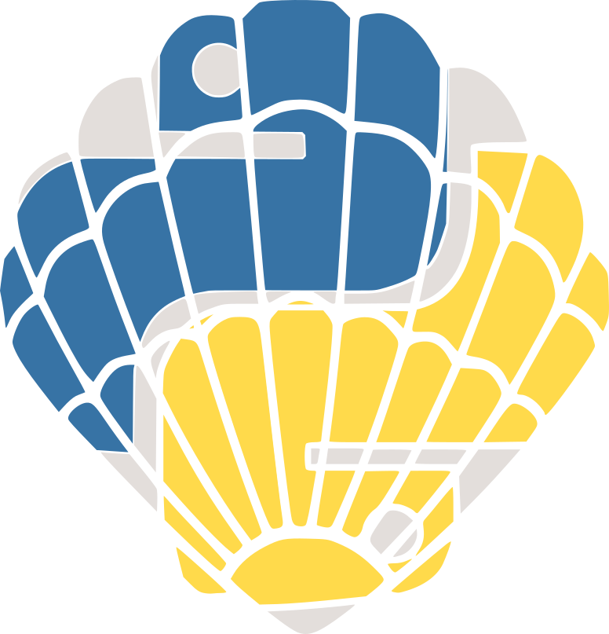

<h1 align="center">

</h1><br>

# SCALLOPS

[](https://badge.fury.io/py/scallops)
[](https://pypi.org/project/scallops/)
[](https://github.com/Genentech/scallops/blob/main/LICENSE)

SCALLOPS (Scalable Library for Optical Pooled Screens) is a Python package for analyzing Optical
Pooled Screens (OPS) imaging data at scale, built on xarray, dask, and zarr.

## Documentation
The full documentation, API reference, and tutorials can be found at: https://scallops.readthedocs.io

## Getting Started

SCALLOPS requires Python 3.12 or newer.

```bash
uv pip install scallops
```

Pre-built Docker images are also published to `ghcr.io/genentech/scallops`. For optional extras,
Docker usage, and setting up a development environment, see the
[installation guide](https://scallops.readthedocs.io/en/latest/install.html).

## Key Features

* **Scales from a laptop to the cloud**: the same commands run locally or distributed via Dask, on
  AWS HealthOmics, Google Cloud Batch, or Terra.
* **Command-line interface**: each pipeline stage (illumination correction, stitching, registration,
  segmentation, feature extraction, barcode calling) is a `scallops` subcommand.
* **WDL pipelines**: end-to-end stitching, OPS, and perturbation-map workflows that can be run as-is
  or composed from their underlying tasks.
* **Standard output formats**: images as OME-Zarr, tables as Parquet, aggregated results as AnnData.
* **Python API**: every pipeline step is also a documented function, for use outside the CLI.
* **Notebook examples**: [example Jupyter notebooks](https://scallops.readthedocs.io/en/latest/example_notebooks.html) walk through real-world workflows.

## Contributing to SCALLOPS

We welcome all forms of contributions, including bug reports, documentation improvements, and feature enhancements.

* Report bugs and request features on the [issue tracker](https://github.com/Genentech/scallops/issues).
* To contribute code, follow the [developer instructions](https://scallops.readthedocs.io/en/latest/install.html#developer-instructions)
  to set up a development environment, create a branch, and open a pull request against `main`. The
  pre-commit hooks run Ruff and mypy; please make sure `pytest -n auto` passes.
