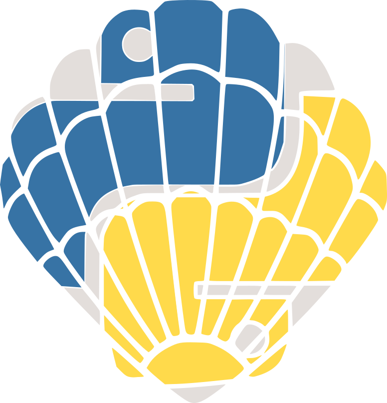

########
SCALLOPS
########

SCALLOPS (**Scal**\ able **L**\ ibrary for **O**\ ptical **P**\ ooled **S**\ creens) is a Python package
for analyzing Optical Pooled Screens (OPS) imaging data at scale, built on xarray, dask, and zarr.

Key Features
------------
* **Scales from a laptop to the cloud**: the same commands run locally or distributed via Dask, on AWS
  HealthOmics, Google Cloud Batch, or Terra (see :doc:`workflows`).
* **Command-line interface**: each pipeline stage (illumination correction, stitching, registration,
  segmentation, feature extraction, barcode calling) is a ``scallops`` subcommand; see
  :doc:`command_line`.
* **WDL pipelines**: end-to-end stitching, OPS, and perturbation-map workflows that can be run as-is or
  composed from their underlying tasks; see :doc:`workflows`.
* **Standard output formats**: images as OME-Zarr, tables as Parquet, aggregated results as AnnData;
  see :ref:`outputs`.
* **Python API**: every pipeline step is also a documented function, for use outside the CLI; see
  :doc:`api`.
* **Notebook examples**: :doc:`example Jupyter notebooks <example_notebooks>` walk through real-world
  datasets.

.. toctree::
   :maxdepth: 2
   :caption: Contents:

   install
   command_line
   example_commands
   workflows
   example_notebooks
   faq
   release_notes
   api
